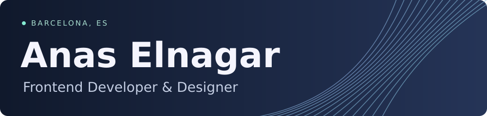

  
  
  

Hi 👋, I'm Anas. I build web experiences in Barcelona, from custom PrestaShop stores to an Arabic daily planner.

### 🛠️ Tech Stack

### 📌 Featured projects

- **[Yawmi · يومي](https://yawmi.in/)** — Arabic daily planner with habit tracking, focus sessions and offline access · [code](https://github.com/onisEg/yawmi)
- **[Hotel Booking 🏨](https://booking-iota-one.vercel.app/)** — React + TypeScript booking platform with Stripe payments · [code](https://github.com/DevsquadEg/booking)
- **[ITAlumni](https://it-alumni-pink.vercel.app/)** — Search graduate profiles, jobs and events · [code](https://github.com/onisEg/itAlumni)

Explore more projects

- **[Project Management System](https://project-management-system-y5bw.vercel.app/)** — Full PMS built with React & TypeScript · [code](https://github.com/onisEg/project-management-system)
- **[Food Recipe 🍇](https://food-app-six-sepia.vercel.app)** — Recipe app with React & TypeScript · [code](https://github.com/onisEg/food_app)
- **[Book Shop 📚](https://bookshop-git-main-onisegs-projects.vercel.app/)** — E-commerce bookstore with dashboard · [code](https://github.com/onisEg/bookshop)
- **[User Management System](https://user-management-system-orpin.vercel.app/)** — Full CRUD user management, React + TS · [code](https://github.com/onisEg/userManagementSystem)
- **[RentCars 🚗](https://cars-mocha-phi.vercel.app/)** — Car rental app built with React · [code](https://github.com/onisEg/cars)
- **[Contacts ➕](https://contacts-indol.vercel.app/)** — Contact manager, React + TypeScript · [code](https://github.com/onisEg/contacts)
- **[eCommerce](https://oniseg.github.io/eCommerce/)** — Storefront with HTML/CSS/JS & Bootstrap · [code](https://github.com/onisEg/eCommerce)

### 🌱 Recent activity

*Preview of the weekly activity section · sample from November 2026*

| Project | Recent milestone |
| --- | --- |
| [ITAlumni](https://github.com/onisEg/itAlumni) | Released the alumni, jobs and events views with search and filters |
| [Yawmi](https://github.com/onisEg/yawmi) | Updated the mobile interface with Liquid Glass styling |

[Visit my portfolio ↗](https://anascv.com)
