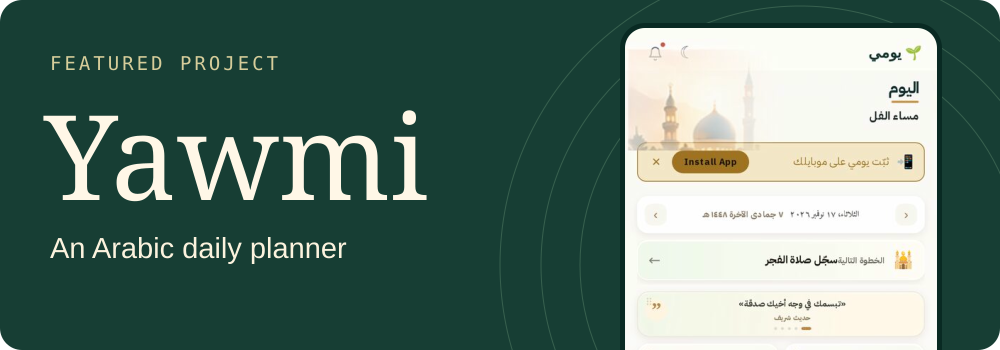

# Anas Elnagar

**Frontend developer & designer · Barcelona**

I design and build web interfaces, from custom PrestaShop stores to an Arabic daily planner that works offline.

[Portfolio](https://resume-git-main-onisegs-projects.vercel.app/) · [LinkedIn](https://linkedin.com/in/anaseg) · [CodePen](https://codepen.io/anasabdo)

**Yawmi · يومي** brings habits, prayer tracking and focus sessions into one daily view. Built for Arabic readers, with a right-to-left interface, offline access and optional account sync.

[Open Yawmi ↗](https://yawmi.in/) · [Explore the code](https://github.com/onisEg/yawmi)

## More selected work

### Hotel Booking
A team project with DevsquadEg. Guests can book a hotel and pay through Stripe. Built with React and TypeScript.

[View demo ↗](https://booking-iota-one.vercel.app/) · [Source code](https://github.com/DevsquadEg/booking)

### ITAlumni
A mobile-first directory for Barcelona Activa’s IT Academy. Search graduates by skill, filter job listings and browse community events. Built with vanilla TypeScript and Tailwind CSS using mock data.

[View demo ↗](https://it-alumni-pink.vercel.app/) · [Source code](https://github.com/onisEg/itAlumni)

---

**Toolkit** · TypeScript · JavaScript · React · Tailwind CSS · Sass · Figma · Git
