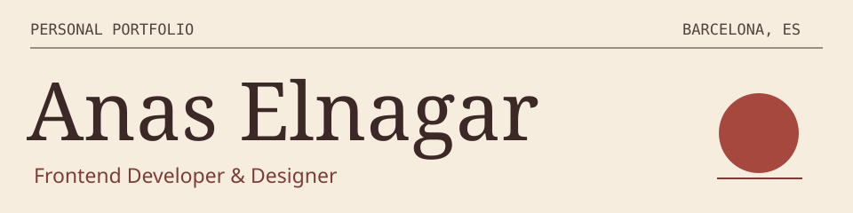

I design and build web interfaces in Barcelona. My work spans Arabic-first productivity tools, community directories and online stores.

[Portfolio](https://anascv.com) · [LinkedIn](https://linkedin.com/in/anaseg) · [CodePen](https://codepen.io/anasabdo)

## Featured work · Yawmi

> What would a daily planner look like if it were designed for Arabic readers from the start?

Yawmi brings habits, prayer tracking and focus sessions together in a right-to-left interface that works offline.

[Try Yawmi](https://yawmi.in/) · [Read the code](https://github.com/onisEg/yawmi)

### Also selected

**[Hotel Booking](https://booking-iota-one.vercel.app/)** — A team-built hotel reservation flow with Stripe checkout. [Code](https://github.com/DevsquadEg/booking)

**[ITAlumni](https://it-alumni-pink.vercel.app/)** — Search graduate profiles, filter job listings and discover events. [Code](https://github.com/onisEg/itAlumni)

### Studio notes

*Weekly feed preview · sample entries*

- [ITAlumni](https://github.com/onisEg/itAlumni) — Added search and filters across alumni, jobs and events.
- [Yawmi](https://github.com/onisEg/yawmi) — Refreshed the Android interface with Liquid Glass styling.

More projects

- **[Project Management System](https://project-management-system-y5bw.vercel.app/)** — Full PMS built with React & TypeScript · [code](https://github.com/onisEg/project-management-system)
- **[Food Recipe 🍇](https://food-app-six-sepia.vercel.app)** — Recipe app with React & TypeScript · [code](https://github.com/onisEg/food_app)
- **[Book Shop 📚](https://bookshop-git-main-onisegs-projects.vercel.app/)** — E-commerce bookstore with dashboard · [code](https://github.com/onisEg/bookshop)
- **[User Management System](https://user-management-system-orpin.vercel.app/)** — Full CRUD user management, React + TS · [code](https://github.com/onisEg/userManagementSystem)
- **[RentCars 🚗](https://cars-mocha-phi.vercel.app/)** — Car rental app built with React · [code](https://github.com/onisEg/cars)
- **[Contacts ➕](https://contacts-indol.vercel.app/)** — Contact manager, React + TypeScript · [code](https://github.com/onisEg/contacts)
- **[eCommerce](https://oniseg.github.io/eCommerce/)** — Storefront with HTML/CSS/JS & Bootstrap · [code](https://github.com/onisEg/eCommerce)

